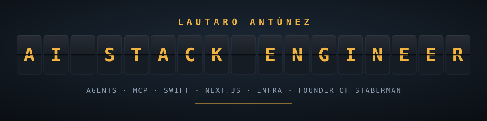

  

  
  

 

# Lautaro Antúnez, AI Stack Engineer

Founder of **[Staberman](https://staberman.com.ar)**, a one-person studio. (Lautaro Antunez, for keyboards without the accent.)

An AI Stack Engineer owns the whole path an AI feature travels: the agent tooling and MCP servers, the LLM calls inside a product, and the apps, databases and servers it all runs on. That is how I work. I build the agent tooling and the products around it, and I run the infrastructure under both, so nothing gets handed off halfway.

---

## Stack

| Layer | |
|---|---|
| **AI and agents** |      |
| **Apple** |      |
| **Web** |      |
| **Data** |   |
| **Infra** |     |
| **Contributes in** |      |

I work in **hexagonal** and **screaming architecture**, with tests that describe behavior instead of implementation. Most of what I build is meant to be maintained for years.

---

## AI agent tooling and open source

Pulled out of the products below. This is the part of my work you can read and run yourself.

**[cc-memory-lint](https://github.com/Staberman/cc-memory-lint)**: a linter for Claude Code auto-memory folders. It reports an index past the size that gets loaded, dead links, orphan files and broken frontmatter. Zero dependencies. MIT.

**[dead-click](https://github.com/Staberman/dead-click)**: finds the buttons and links a real user cannot click because another element is on top of them, at every viewport you list. Built after a decorative glow layer ate a call-to-action at desktop width while every test passed. Node and Playwright. MIT.

I also audit open-source agent tooling and MCP servers (see Security below). A fix PR for one of them is open in Google's mcp-toolbox.

| Repo | What it is |
|---|---|
| [app-attest-gate](https://github.com/Staberman/app-attest-gate) | The parts of Apple App Attest people usually hand-roll wrong. Single-use challenges, atomic replay protection, per-assertion environment pinning and request-body binding, paired with StoreKit 2 entitlements and a server-metered free tier. MIT. |
| [AppAttestClient](https://github.com/Staberman/app-attest-client) | The Swift half. A Secure Enclave request signer whose concurrent registrations collapse into one, so a fresh install can't race itself into a 401. MIT. |
| [SplitFlap](https://github.com/Staberman/splitflap) | Split-flap departure board components for SwiftUI, extracted from Pomotti. Tiles flip, rows spell themselves out, and a `Canvas` fast path keeps a large board at frame rate. MIT. |
| [ntag213-ndef](https://github.com/Staberman/ntag213-ndef) | NDEF bytes that iOS background tag reading actually accepts, plus an NTAG213 lock verifier that reads page `02h` instead of the one that misleads you. Zero dependencies. MIT. |
| [claude-watch](https://github.com/Staberman/claude-watch) | Control Claude Code from an Apple Watch. My fork keeps the session controls within reach and holds the bridge connection when you lower your wrist. |
| [app-store-connect-gotchas](https://github.com/Staberman/app-store-connect-gotchas) | 41 App Store Connect traps indexed by the exact error string, each with symptom, cause, fix and a way to verify. Review, signing, TestFlight API, screenshots. MIT. |

---

## Contributions

- **[Tomari](https://github.com/elrincondeldev/tomari)** (macOS, Swift): Claude Code sessions as little creatures on the edge of the screen. I made it usable with plain terminal sessions, without the desktop app ([merged](https://github.com/elrincondeldev/tomari/pulls?q=is%3Apr+author%3AStaberman+is%3Amerged)), and have more PRs open: a hotkey to jump to a waiting session, chimes, per-project colors.
- **[AsoBeast](https://github.com/AsoBeast/asobeast)** (TypeScript): open-source ASO and keyword rank tracking for the App Store and Google Play. I fixed error states in the web app so a failed load says what failed ([merged](https://github.com/AsoBeast/asobeast/pulls?q=is%3Apr+author%3AStaberman+is%3Amerged)).
- **In review:** PRs to [mcp-toolbox](https://github.com/googleapis/mcp-toolbox/pull/4540), [rtk](https://github.com/rtk-ai/rtk/pull/5123), [ezbookkeeping](https://github.com/mayswind/ezbookkeeping/pull/774) and [better-claude](https://github.com/midudev/better-claude/pulls?q=is%3Apr+author%3AStaberman).

---

## Security

I audit open-source AI agent tooling and Model Context Protocol (MCP) servers, and report what I find through each project's coordinated-disclosure channel. The work is about security-control bypasses: a read-only flag that a crafted string slips past, a tool allow-list that a parser disagrees with, an SSRF guard that checks the wrong host. Details stay private until the maintainer publishes the advisory, so most of this isn't linkable yet. Credited advisories will appear here as they go public.

What's public today: a fix PR to **[mcp-toolbox](https://github.com/googleapis/mcp-toolbox/pull/4540)** (Google) closing an RDF-injection hole in the Dgraph source.

---

## What I build

**📱 iOS and macOS.** Three apps built solo and submitted to the App Store: a Pomodoro timer styled as a split-flap departure board (SwiftUI, iOS + iPadOS + macOS), a journaling app with an AI backend (SwiftUI), and an expense tracker with native StoreKit 2 subscriptions (React Native / Expo).

**Wallet passes.** A loyalty platform where the card lives in Apple Wallet, with Google Wallet in a pilot. Customers scan a QR and get the card without installing anything; the business adds stamps and sends messages to the lock screen. Next.js 16, an append-only points ledger, and a separate Node worker that is the only process allowed to touch the signing certificate. In production.

**Multitenant SaaS.** A marketing analytics panel on Next.js 16 and self-hosted Supabase: row-level security across a five-role tenant hierarchy, batched ingestion that collapsed **9,000 API calls into 18**, cron-driven alerting, and **1,229 passing tests**.

**Commerce and automation.** Digital storefronts with paid acquisition on Meta, a WhatsApp sales bot with its own CRM, and an outbound prospecting pipeline that runs unattended on my own server and has worked through **700+ leads**.

**Client work.** An offline-first point-of-sale PWA for a restaurant that keeps taking orders when the network drops. An operations panel for a currency exchange business with live bank connections through Plaid. A dynamic QR and NFC redirect service on the client's own domain. An eyewear and watch storefront whose stock and prices sync from Tiendanube every hour.

---

## How I work

> **Specs before code.** Larger changes start as a written spec, a design and a task list, and get checked against them before they merge.

> **Review scales with risk.** Anything touching auth, payments or infrastructure gets an adversarial review before it ships. Copy changes don't.

> **I run my own infrastructure.** When something breaks in production, I'm usually the first to know.

---

Most of my repositories are private: client work, live commercial products, or personal data. Happy to walk through any of it on a call.

  

<a href="mailto:lautaro@staberman.com.ar"><b>lautaro@staberman.com.ar</b></a> · <a href="https://staberman.com.ar"><b>staberman.com.ar</b></a>

